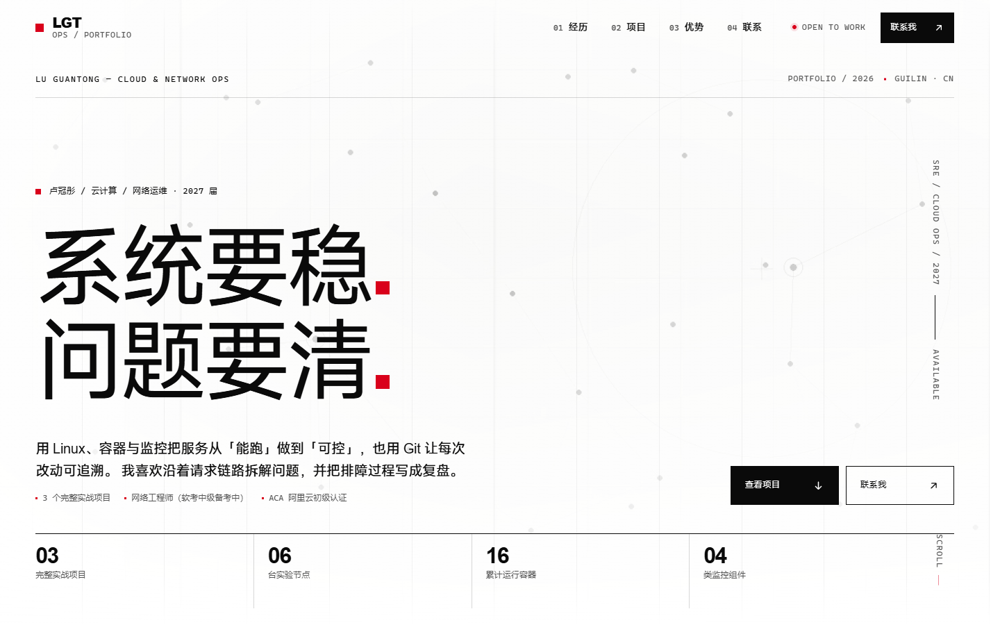
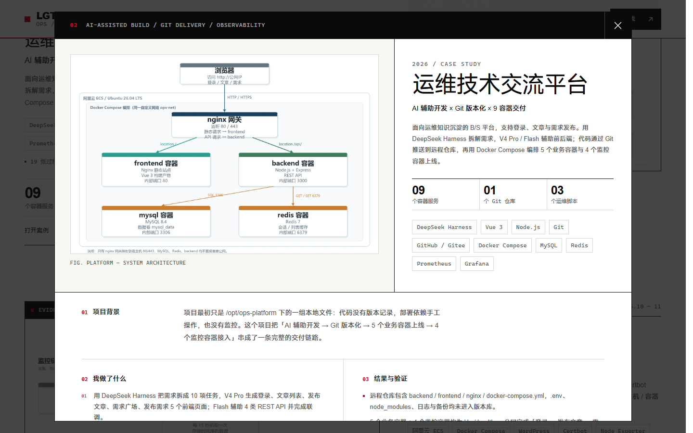

<h1 align="center">卢冠彤 · 云计算与网络运维作品集</h1>

<p align="center"><strong>系统要稳，问题要清。</strong></p>

<p align="center">
  React 19 · Vite 7 · 瑞士网格 · 3 个实战项目 · 36 张项目证据图
</p>



## 项目简介

这是一个以真实实训项目为内容的个人作品集网站。它不追求堆叠技术名词，而是把每个项目从**背景、动作、结果到故障复盘**讲清楚。

网站使用 React + Vite 构建，包含全屏视频 Hero、个人经历、三个可展开的项目案例、个人能力卡片和整屏联系页。所有项目配图来自实训文档，已转为 WebP 并按项目分组，点击可查看原图。

**当前定位：** 2027 届，寻找云计算 / 网络运维 / SRE 实习。

## 核心亮点

- **3 个完整项目**：从高可用 LNMP、Git 版本化平台部署，到 Docker Compose 博客监控，覆盖 Linux、网络、容器、CI/CD 与可观测性。
- **Git 工程化**：项目二单独整理 SSH 密钥、`.gitignore`、首次提交、远程仓库、部署公钥与 `v1.0.0` 标签。
- **36 张原始证据图**：终端、浏览器、HAProxy、MySQL、Prometheus、Grafana 截图全部按项目分组，点击可查看原图。
- **非模板化视觉**：1700px 瑞士网格、白底黑字信号红、零圆角、细网格，配套本地视频背景与响应式排版。

## 三个项目

| 项目 | 技术关键词 | 可验证数据 | 证据图 |
| --- | --- | --- | --- |
| 01 · 高可用 LNMP 与云迁移 | HAProxy、Keepalived、Nginx、MySQL 主从、腾讯云 ECS | 6 台节点、5 类故障演练、VIP 漂移 | 8 张 |
| 02 · 运维技术交流平台 | Git、GitHub / Gitee、DeepSeek、Docker Compose、Prometheus、Grafana | 9 个容器（5 业务 + 4 监控）、1 个 Git 仓库、3 个运维脚本 | 19 张 |
| 03 · Docker Compose 博客与监控 | 阿里云 ECS、WordPress、Certbot、Prometheus、Node Exporter、cAdvisor | 7 个容器、6 块 Grafana 面板、2 条告警规则 | 9 张 |

项目二在案例详情中单独拆出 **「Git 版本化 / 项目上 Git」** 区块，覆盖 SSH 密钥、`.gitignore`、首次提交、远程仓库、部署公钥与 `v1.0.0` 标签。

## 项目预览



- 首页：全屏视频背景、1700px 版心、瑞士网格排版。
- 项目卡片：大图架构证据、项目指标、案例入口。
- 案例弹窗：项目背景、个人动作、结果验证、故障复盘、Git 专项、过程证据。
- 联系页：邮箱复制、电话、本地时间、回到顶部。

## 技术栈

- **框架：** React 19 + Vite 7
- **样式：** 原生 CSS、CSS Variables、Grid / Flex、无 UI 组件库
- **动效：** IntersectionObserver 滚动揭示、`prefers-reduced-motion` 适配
- **多媒体：** 本地生成的抽象网络视频背景，不依赖外部 CDN
- **素材：** WebP 图片、SVG 人物插画、本地静态资源

## 本地运行

```bash
pnpm install
pnpm dev
```

也可以使用 npm：

```bash
npm install
npm run dev
```

打开 **http://127.0.0.1:5173**。

要求 Node.js 20+。

> 不要直接双击 `index.html`。入口是 Vite 的 `/src/main.jsx`，必须通过开发服务器或 `preview` 访问，否则会出现资源加载失败。

## 构建与部署

```bash
pnpm build
pnpm preview
```

构建产物输出到 `dist/`，可直接部署到任意静态托管服务。站点资源全部在本地，不依赖外部图片或字体 CDN。

> 如果部署到子路径，请在 `vite.config.js` 中配置对应的 `base`。

### 部署到 Cloudflare Pages

在 Cloudflare Pages 里连接 Git 仓库后，按下面的配置填写：

| 配置项 | 值 |
| --- | --- |
| Framework preset | Vite |
| Root directory | 留空（仓库根目录） |
| Build command | `pnpm build`（或 `npm run build`） |
| Build output directory | `dist` |
| 环境变量 | `NODE_VERSION=22` |

如果构建日志出现：

```text
Failed to resolve /src/main.jsx from /opt/buildhome/repo/index.html
```

说明 **Git 仓库里缺少 `src/` 目录**，不是 Cloudflare 配置问题。请确认仓库根目录至少包含：

```text
index.html
package.json
pnpm-lock.yaml
vite.config.js
src/main.jsx
src/App.jsx
src/components/
src/data/
src/styles/
public/
```

> 用 GitHub 网页版上传时，只选根目录文件是不够的，必须把 `src/`、`public/`、`docs/` 三个文件夹一起上传。README 里的预览图裂开，也说明 `docs/` 没有上传。

也可以不接 Git 自动构建，直接执行 `pnpm build`，把本地 `dist/` 目录上传到 Cloudflare Pages 的 Direct Upload。

## 目录结构

```text
.
├── docs/                       # README 预览截图
├── public/
│   ├── _redirects              # Cloudflare Pages SPA 回退
│   ├── favicon.svg
│   ├── robots.txt
│   └── media/
│       ├── hero.mp4            # 本地视频背景
│       ├── hero-poster.webp
│       ├── portrait.svg        # 几何人物肖像占位
│       ├── project1/           # 项目一证据图 8 张
│       ├── git/                # Git 证据图 5 张
│       ├── platform/           # 平台与监控证据图 13 张
│       └── docker/             # Docker 证据图 9 张
├── src/
│   ├── components/             # Hero / Profile / Projects / Modal / Contact
│   ├── data/content.js         # 全站文案、项目数据、图片映射
│   ├── hooks/                  # 滚动揭示、滚动监听、滚动锁
│   ├── styles/                 # tokens.css / base.css
│   ├── App.jsx
│   └── main.jsx
├── .nvmrc                      # Node 22
├── index.html
├── package.json
└── vite.config.js
```

## 设计与实现

- **视觉：** 白底 + 黑色文字 + 单一信号红 `#D9001B`，零圆角、细网格、无阴影。
- **版心：** PC 端最大 1700px，左右自适应留白；桌面优先，同时适配平板与手机。
- **字体：** Helvetica / Arial 负责英文，PingFang SC / Microsoft YaHei 负责中文；技术标签使用等宽字体。
- **信息层级：** 每个区块一个主标题，项目数据用大号数字和细线表格呈现，避免模板化卡片堆叠。
- **可访问性：** 语义化标签、图片 `alt`、键盘焦点、`Esc` 关闭弹窗、焦点回收、背景滚动锁定。

## 素材与内容说明

- 项目一详情页包含 8 张原始证据图，分为「验证与运行证据」和「故障与高可用证据」两组。
- 项目二详情页包含 19 张证据图：Git 5 张、平台部署与运行 11 张、监控与告警 3 张。
- 项目三详情页包含 9 张证据图：部署与运行 3 张、监控与告警 6 张。
- `public/media/portrait.svg` 是按瑞士网格风格绘制的几何人物肖像占位，不是真人照片；上线前可替换为本人 4:5 照片。
- 项目事实以实训文档为准；技能描述按简历口径整理，软考中级写作“备考中”，不把计划写成已获得的证书。

## 联系方式

- 邮箱：3082840750@qq.com
- 地点：桂林 · 中国
- 求职方向：云计算 / 网络运维 / SRE 实习

## 版权说明

本仓库用于个人求职作品展示。站内文案、项目截图与实训资料未经授权，请勿转载或用于商业用途。

---

<p align="center"><sub>Designed & built by 卢冠彤 · 2026</sub></p>
